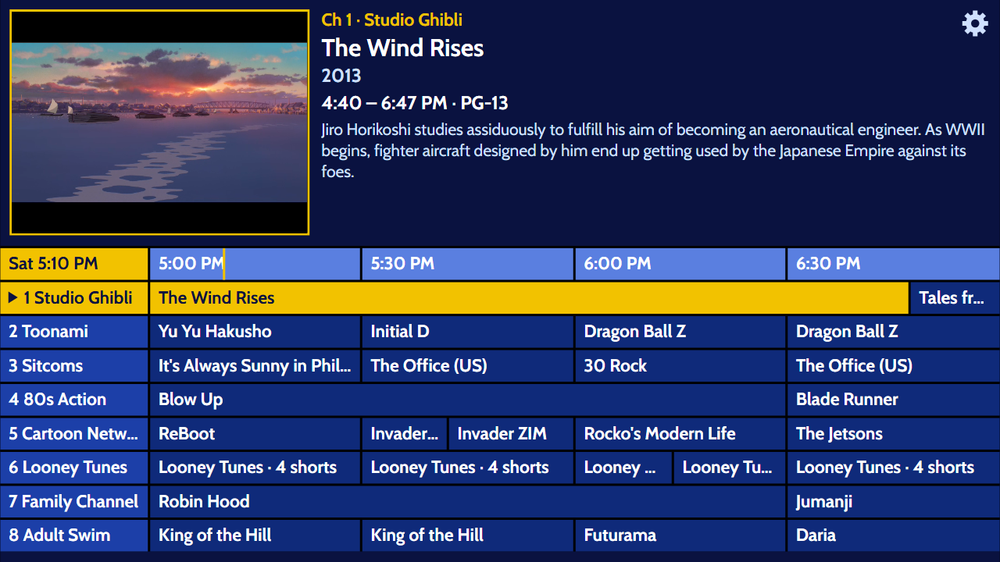
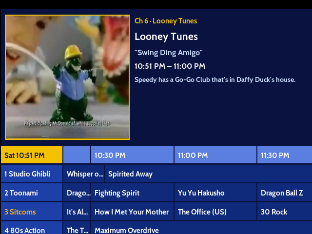
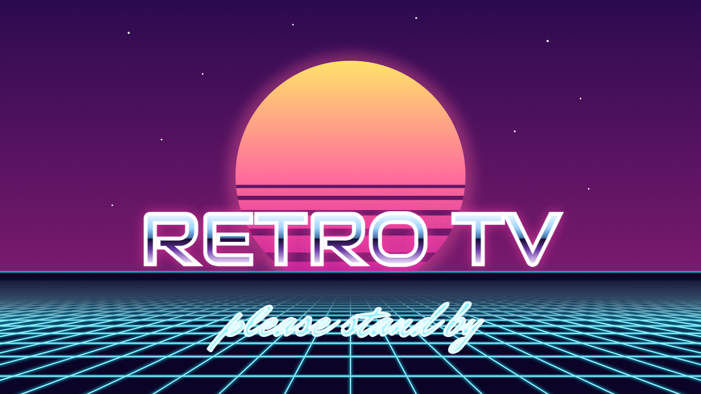
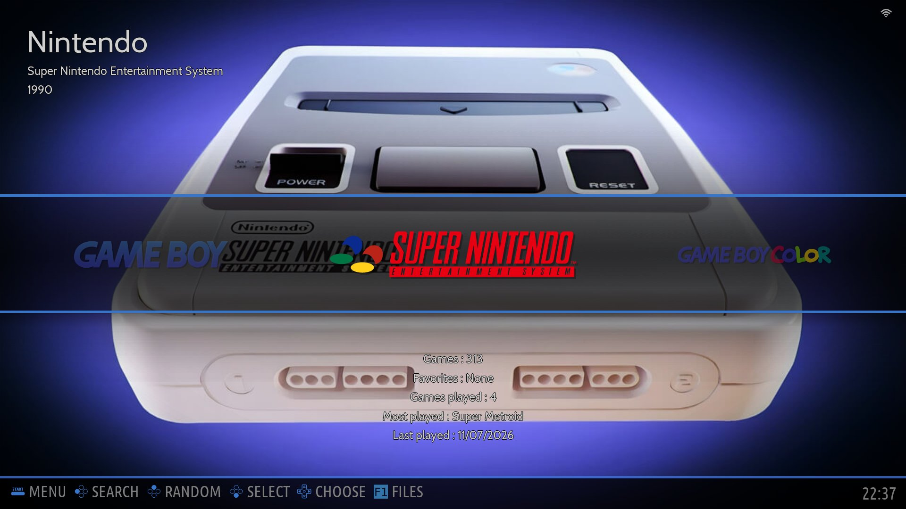
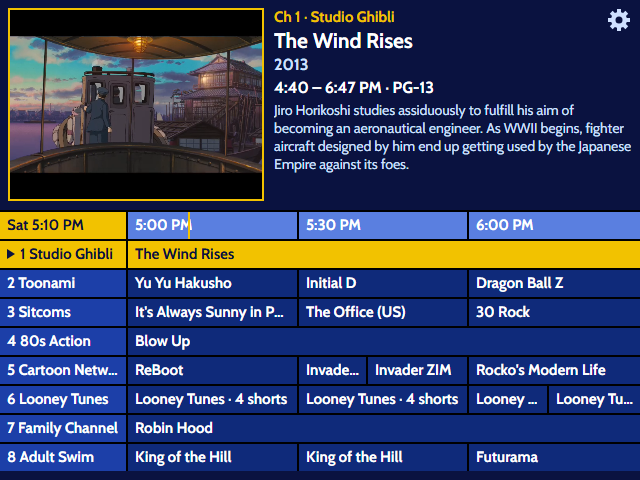
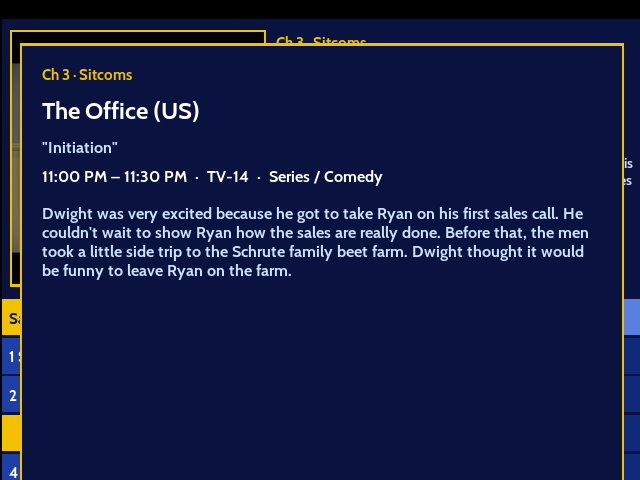

# retro-tv

<p align="center">
  <b>Home</b> &nbsp;·&nbsp;
  <a href="docker/README.md">Browser app</a> &nbsp;·&nbsp;
  <a href="pi/README.md">Batocera Pi</a> &nbsp;·&nbsp;
  <a href="pi-image/README.md">Retro TV box</a> &nbsp;·&nbsp;
  <a href="roku-tv/README.md">Roku</a> &nbsp;·&nbsp;
  <a href="ersatztv/README.md">ErsatzTV channels</a>
</p>

A 90s living room, rebuilt: round-the-clock "cable" channels with commercials, a navy-and-yellow
TV guide, and retro games, on real CRTs and on whatever screen is nearest. One home server runs
the channels; several small boxes and apps tune in.

<p align="center"></p>
<p align="center"><sub>The guide in a browser. Pick a show, it plays; it keeps playing in the corner while you browse.</sub></p>

## The pieces

```
                 ┌──────────────────────────────────────────────┐
                 │  Home server: ErsatzTV (port 8409)           │
                 │  Scheduled channels from your media library, │
                 │  ads between and inside programmes, a guide  │
                 └──────────────┬───────────────────────────────┘
                                │  channel list (M3U), guide (XMLTV), streams
        ┌───────────────┬───────┴────────┬─────────────────┬──────────────────┐
        ▼               ▼                ▼                 ▼                  ▼
  Batocera Pi 4    Retro TV box      Browser app        Roku app         Any player
  Kodi, retro      Pi 4 that boots   Docker container   SceneGraph       mpv, VLC …
  guide skin,      straight into     with the guide,    channel for a
  retro games,     the guide on a    open it on a       Roku on the
  HDMI TV or CRT   CRT               laptop or phone    home network
```

| Piece | What it is | Start here |
|---|---|---|
| **ErsatzTV channels** | How the channels are built: video profile for a CRT, smart collections, ad breaks, schedules, the commercials catalog and a script to rebuild them | [`ersatztv/README.md`](ersatztv/README.md) |
| **Browser app** | The TV guide viewer: plain HTML/CSS/JS behind nginx, in Docker. Pick a show, it plays; keeps playing in the corner while you browse. Nine themes (Cable, Vaporwave, Digital Cable, Satellite, DVR, Media Center, Aqua, Set-Top Web, TV Guide), each with its own splash screen | [`docker/README.md`](docker/README.md) |
| **Batocera Pi** | A Raspberry Pi running Batocera 43.1: retro games, Kodi live TV with a cable-style guide skin, Plex, and two display profiles (a flat HDMI TV, or a 4:3 CRT through a composite converter) | [`pi/README.md`](pi/README.md), full guide in [`docs/`](docs/index.html) |
| **Retro TV box** | A Raspberry Pi as an appliance: a stock Pi OS Lite card plus one script becomes a box that boots to the guide full screen on a CRT, with a themed boot splash and an IR remote | [`pi-image/README.md`](pi-image/README.md) |
| **Roku** | The same guide and channels as a sideloaded Roku channel | [`roku-tv/README.md`](roku-tv/README.md) |

Everything downstream of the server is a **viewer**: it reads ErsatzTV's channel list, listings and
streams and changes nothing. The server's web page and API are never exposed; only the three
read-only `/iptv/` paths get through.

## In pictures

<table><tr><td align="center"><br><sub>A game on the Batocera Pi, through the Trinitron shader</sub></td><td align="center"><br><sub>Kodi's retro guide at the CRT's 640×480</sub></td><td align="center"><br><sub>The browser app's Vaporwave splash</sub></td></tr></table>

<table><tr><td align="center"><br><sub>Batocera's system view</sub></td><td align="center"><br><sub>The Retro TV box: the guide at 640×480</sub></td><td align="center"><br><sub>Show details in Kodi</sub></td></tr></table>

## What you need

Only the server is required. Pick whichever viewers suit the screens you have.

| | |
|---|---|
| Server | Any machine that runs [ErsatzTV](https://ersatztv.org) (Docker or Kubernetes) and can reach your media. A GPU or other hardware encoder helps once several channels are watched at the same time |
| Browser app | Anything that runs Docker |
| Batocera Pi | A Raspberry Pi 4, a game controller, and an HDMI TV; for a CRT, an HDMI-to-composite converter |
| Retro TV box | A Raspberry Pi 4 (2 GB is plenty) and a TV with HDMI or composite input; an IR receiver is optional |
| Roku | A Roku on the same network as the server |

Each piece's page lists its parts in detail and names the hardware it was built and tested on.

## Repo map

| Folder | What's in it |
|---|---|
| `docs/` | The HTML guide to the Batocera Pi (open `docs/index.html` in a browser): setup, game library, shaders, display profiles, live TV, reference |
| `pi/display-profiles/` | The HDMI / CRT profile switcher and its helpers, installed on the Batocera Pi |
| `pi/kodi-skin/` | Kodi's retro TV guide and show details screens, and the live-TV controller map |
| `pi/scripts/` | Batocera launch hooks (`/userdata/system/scripts/`) |
| `pi/shaders/` | Shader sets and the Trinitron-style CRT presets |
| `pi/snapshots/` | Sanitized copies of the Batocera Pi's config files |
| `tools/` | Scripts run from a PC or copied to the Pi: flashing, importing a game library, BIOS check, shader benchmarks |
| `tools/render-splash/` | Renders the viewer's splash scenes to PNG for the Roku app and the box's boot screen |
| `docker/` | The browser app (Docker Compose) |
| `roku-tv/` | The Roku app |
| `pi-image/` | The Retro TV box: design, config, `setup.sh`, boot splash, IR key map |
| `ersatztv/` | How the channels are built, and the commercials |

## Conventions

- **Addresses are placeholders.** `<pi-ip>` is a Pi on the home network and `<server-ip>` the
  machine running ErsatzTV (port 8409). Fill them in locally; real addresses live in git-ignored
  files (`docker/.env`, `/etc/retro-tv.env` on the box).
- **Not in this repo:** ROMs, BIOS files, box art, SSH keys, the ScreenScraper login, and anything
  from the ErsatzTV server's config (`.gitignore` blocks the first ones).
- **Line endings.** Files that run on the Pis keep Unix line endings whatever the PC says
  (`.gitattributes`); a shell script with Windows line endings fails on Batocera.
- **HD twins.** The server gives every channel an HD copy (number + 1000, group `HD`) for modern
  screens. The CRT boxes hide that group; the browser app and the Roku offer Standard / HD.

## License

The code and documentation in this repository are released under the [MIT License](LICENSE).

Files that come from other projects keep their own terms, which sit next to them: the fonts
(`*-LICENSE-OFL.txt` in the `fonts/` folders) and hls.js (`docker/web/app/vendor/hls.js-LICENSE`).
The Prevue Grid font is not ours and has no stated licence; see
`docker/web/app/fonts/PrevueGrid-NOTICE.txt`. No TV programmes, commercials or games are included.
