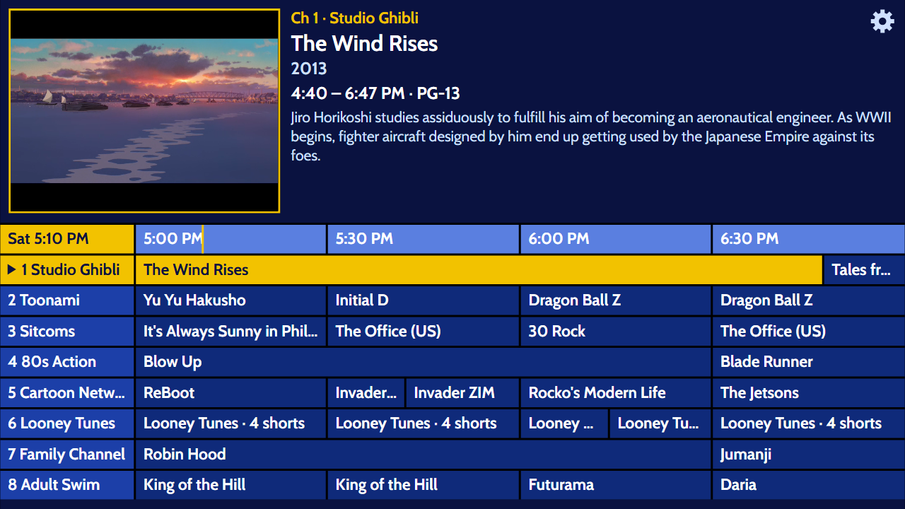
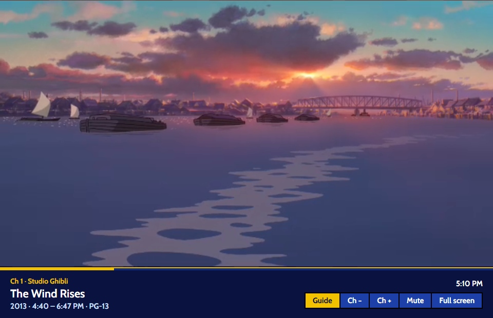
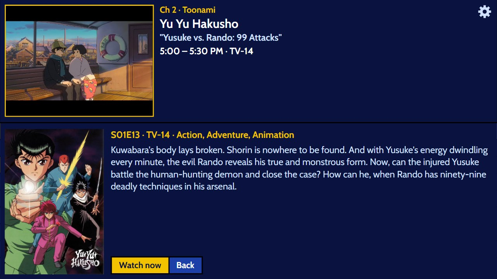
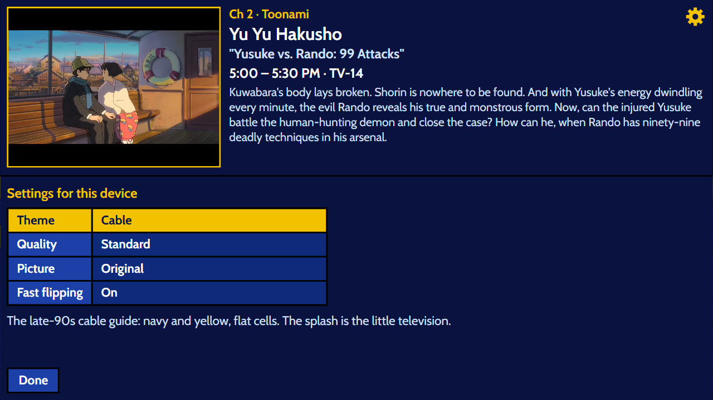
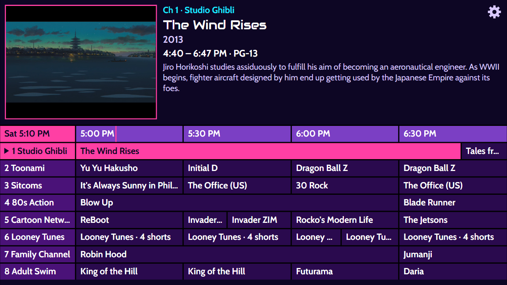
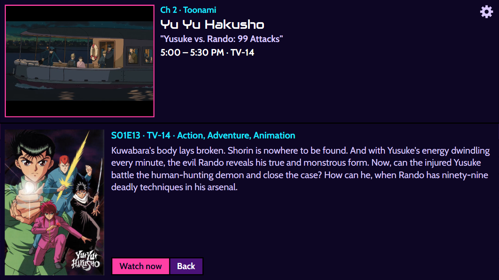
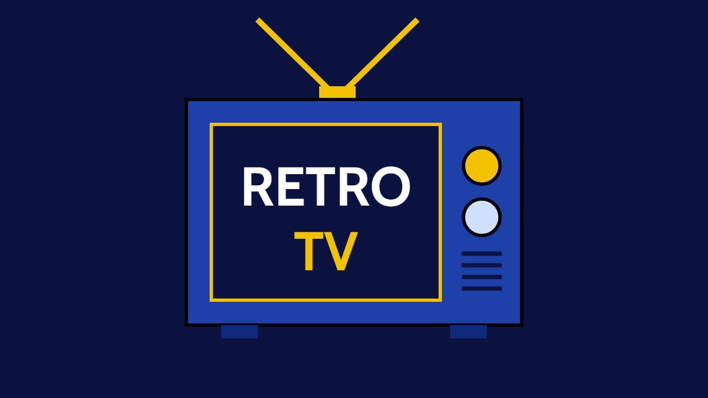
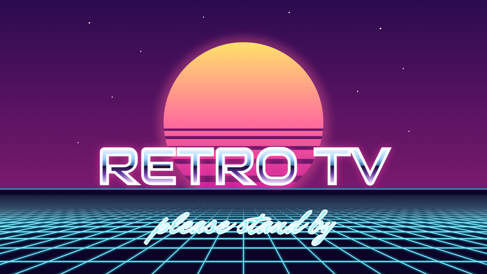
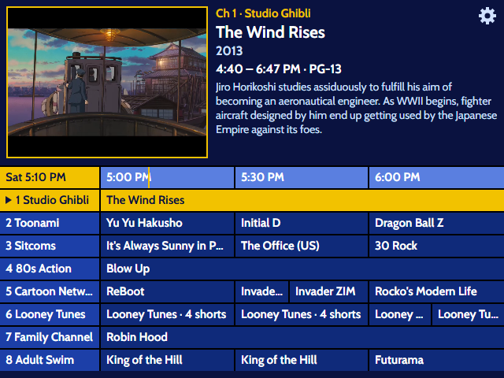
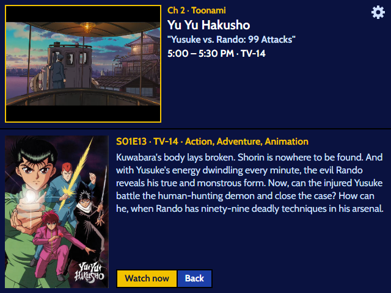

# Retro TV guide viewer

<p align="center">
  <a href="../README.md">Home</a> &nbsp;·&nbsp;
  <b>Browser app</b> &nbsp;·&nbsp;
  <a href="../pi/README.md">Batocera Pi</a> &nbsp;·&nbsp;
  <a href="../pi-image/README.md">Retro TV box</a> &nbsp;·&nbsp;
  <a href="../roku-tv/README.md">Roku</a> &nbsp;·&nbsp;
  <a href="../ersatztv/README.md">ErsatzTV channels</a>
</p>

The late-90s cable guide from the Trinitron, in a web browser: open the page, the guide appears,
pick a show, it plays. The show keeps playing in the corner box while you browse.

It is a viewer only. It reads ErsatzTV's channel list, listings and streams, and can change
nothing on the server.

```
browser ──► Gantry (this machine's proxy) ──► retro-tv container (nginx)
                                                ├─ /        the guide (static files)
                                                └─ /iptv/…  read-only pass-through ──► ErsatzTV
```

The proxy in that picture is [Gantry](https://github.com/awall451/gantry), a companion project by the same author: a Docker
dashboard with a Caddy reverse proxy built in. It watches the Docker socket and gives every
container with a published port a name, `retro-tv.localhost` at the desk and
`https://retro-tv.<your domain>` from a phone over Tailscale, with a real certificate and nothing
open to the internet. It is optional: without it the viewer is at `http://localhost:8410` on the
machine that runs it, and any other reverse proxy can stand in its place.

## Screens

<table><tr><td align="center"><br><sub>The guide, with the picture in the corner box</sub></td><td align="center"><br><sub>Watching: the channel banner over the picture</sub></td></tr></table>

<table><tr><td align="center"><br><sub>Show details</sub></td><td align="center"><br><sub>Settings: theme, quality, picture, fast flipping</sub></td></tr></table>

<table><tr><td align="center"><br><sub>The Vaporwave theme</sub></td><td align="center"><br><sub>Vaporwave details, Audiowide titles</sub></td></tr></table>

<table><tr><td align="center"><br><sub>The Cable splash, shown on load</sub></td><td align="center"><br><sub>The Vaporwave splash</sub></td></tr></table>

<table><tr><td align="center"><br><sub>The ?tv layout at the CRT's 640×480</sub></td><td align="center"><br><sub>Details at 640×480</sub></td></tr></table>

## Run it

Needs Docker with Compose, and an ErsatzTV server this machine can reach.

```bash
cd docker
cp .env.example .env        # then set ERSATZTV_URL in .env
docker compose up -d --build
```

Then open <http://localhost:8410>.

`.env` is git-ignored: the server's real address lives only there.

| Setting | Meaning |
|---|---|
| `ERSATZTV_URL` | Where ErsatzTV answers, as seen from this machine: `http://<server-ip>:8409`. No trailing slash. If the server is also on your tailnet, use its tailnet address and the viewer works at home and away. |
| `VIEWER_PORT` | Port the viewer is published on. Default `8410`. |
| `VIEWER_BIND` | Where that port is open. Default `127.0.0.1` (this machine only; other devices come in through Gantry, see below). `0.0.0.0` also opens it to every device on the local network, with no login. |
| `COMPOSE_FILE`, `UPLINK_PORT`, `UPLINK_BIND` | Only for the uplink add-on, below. |

After changing a file under `web/`, run `docker compose up -d --build` again. After changing only
`.env`, `docker compose up -d` is enough.

### If the guide says "Can't reach the TV server"

…although `curl $ERSATZTV_URL/iptv/channels.m3u` works on the machine itself: containers on
Docker's bridge networks cannot reach other machines there. Some distributions ship with IP
forwarding switched off (`sysctl net.ipv4.ip_forward` prints `0`), and Docker needs it.

Either switch forwarding on (a system setting; your call), or use the uplink add-on, which needs no
system change. Add this line to `.env` and run `docker compose up -d --build` again:

```
COMPOSE_FILE=compose.yaml:compose.uplink.yaml
```

That starts a second small container, `retro-tv-uplink`, on the host's network. The viewer sends
its ErsatzTV requests to it and it passes them on. It listens on the Docker bridge address only
(`172.17.0.1:8411`; change with `UPLINK_BIND` and `UPLINK_PORT`), so other machines cannot reach it.

## Reach it from other devices (Gantry)

The viewer's port is published on loopback, so by itself it is reachable from this machine only.
[Gantry](https://github.com/awall451/gantry), the reverse proxy this machine runs, is the way in from elsewhere.
It finds the container by its published port and routes it under the container's name:

- `http://retro-tv.localhost` on this machine
- `https://retro-tv.<your Gantry tailnet domain>` from any device on the tailnet

For a shorter name, add a manual route in Gantry (for example hostname `tv`, port `8410`).

Not running Gantry? Any reverse proxy that can reach `127.0.0.1:8410` does the same job, or set
`VIEWER_BIND=0.0.0.0` in `.env` to open the port to the local network directly.

Keep it on the tailnet. Do not publish it to the internet (no Funnel, no port forwarding).

## Using it

| | Keyboard | Controller | Mouse / touch |
|---|---|---|---|
| Move around the guide | Arrow keys | D-pad or left stick | Drag the grid, or the wheel (Shift + wheel for time) |
| Watch the highlighted show | Enter | A / Cross | Click or tap it |
| Show details | I | X / Square | Right-click or long-press |
| Back (guide ⇄ picture) | Esc or Backspace | B / Circle | Tap the picture, then **Guide** |
| Channel up / down while watching | Page Up / Page Down, or Up / Down | R1 / L1, or D-pad | **Ch +** / **Ch −** on the banner |
| Page through channels in the guide | Page Up / Page Down | R1 / L1 | Drag |
| Go to a channel by number | Type the number | | |
| Channel banner while watching | Enter | A / Cross | Click or tap the picture |
| Sound on / off | M | | **Mute** on the banner |
| Browser full screen | F | | **Full screen** on the banner, or double-click the picture |
| Settings | S | Y / Triangle, or Start | The cog, top right of the guide |
| Re-read the listings now | R | | |

- Select always tunes the channel and goes straight to the picture, even on a show that has not
  started yet: you get what is on now, like a real TV.
- Up and Down keep your place in time. They never jump back to "now".
- Short programmes that share a title (cartoon shorts) are drawn as one cell per half hour. The
  details screen lists them one by one.
- Times are shown in the viewing device's own time zone.
- The page remembers the last channel and highlights it next time. It does not start playing by
  itself.
- **The splash.** Opening or reloading the page shows the theme's splash for about 2½ seconds
  while the listings load: a little television for Cable, a sunset over a scrolling grid for
  Vaporwave. The scenes are drawn in `js/splash.js`; the grid is a true perspective projection,
  so the same code can draw it on a Pi's boot screen.
- Add `?tv` to the address for the plain 640×480 layout, whatever the window's shape.
- **Full screen** on a phone or tablet also turns the screen on its side. (iPhones cannot put a
  page in full screen; there the button hands the picture to the phone's own video player.)

### Settings

The cog opens settings. They are kept by the browser they were set in, so each device has its own.

| Setting | Choices |
|---|---|
| Theme | **Cable**: the late-90s guide, navy and yellow, flat cells. **Vaporwave**: purple cells, pink highlights, cyan text, chrome titles. Each theme has its own splash (below); changing the theme replays it. |
| Quality | **Standard**: the 4:3 picture made for the old TV. **HD**: the same channels in widescreen 1080p. The guide, names and numbers do not change. Only shown when the server has HD twins (below). |
| Picture | **Original**: the whole 4:3 picture, as on the TV. **Fill the screen**: while watching, zooms in until the black bars around a widescreen show are off the screen; a true 4:3 show is left as it is. For wide monitors. The zoom follows the picture, so it can change when a 4:3 commercial follows a widescreen film. |
| Fast flipping | **On**: the next channel is warmed up while you flip (see below). **Off**: channels start only when tuned. |

### HD twins on the server

HD is not a second set of channels in the guide. For each channel the server can have a hidden
"twin" that plays the same programme at the same time in HD, and the Quality setting makes the
viewer ask for the twin instead. The viewer recognises a twin in ErsatzTV's channel list by two
things:

- its **Group** is `HD`
- its **number** is the channel's number plus 100 (channel 1 → 101)

In ErsatzTV a twin is a channel with Playout Source **Mirror**, Mirror Source Channel set to the
channel it copies, an HD FFmpeg profile, Streaming Engine **Next**, and **Show In EPG** off.
See `../ersatztv/README.md` ("HD copies of every channel") for why not Legacy.
A channel without a twin simply plays in Standard.

Other players that read ErsatzTV's channel list directly (Kodi) will see the twins as extra
channels unless they skip the `HD` group (filter the M3U, or show only the channel group the
normal channels are in). More on twins: [`../ersatztv/README.md`](../ersatztv/README.md), "HD
copies of every channel".

## Good to know

- **One stream while watching.** Each stream is a live transcode on the server. Highlighting
  shows in the guide streams nothing; only the channel you watch is streamed.
- **Flipping channels warms up the next one.** After a channel up or down, the viewer starts the
  next channel in the same direction on the server ahead of time, so the following flip shows a
  picture in a fraction of a second instead of 2 to 4. This stops 30 seconds after your last
  flip. Choosing from the guide or typing a number is always a cold start.
- **Flipping very fast skips the channels in between**: only the one you land on is started.
- **The server can only run so many channels at once** (8 on a consumer NVIDIA card), and a
  channel keeps running there for a while after you leave it (about 90 seconds on ErsatzTV
  v26). Surfing through more than that in one stretch fills the server: the new channel then
  fails until older ones time out. The viewer retries by itself.
- **A hidden tab stops after 5 minutes** and picks the channel up again when you come back, so a
  forgotten tab does not keep the server working all night.
- **Sound may start off.** Browsers allow sound only after a key press or click on the page. A
  controller button does not count, so if you start with a controller you may see "Sound is off":
  press any key or click once.
- **Listings refresh** every 15 minutes, when the tab comes back into view, and on R.
- Checked in Chrome on Linux (desktop and phone-sized windows). Safari and iPhones use the
  browser's own HLS player instead of hls.js; that path has not been tried on a real device yet.

## What gets through to ErsatzTV

Only `GET` requests, and only these paths (see `web/nginx.conf.template`):

| Path | What |
|---|---|
| `/iptv/channels.m3u` | Channel list |
| `/iptv/xmltv.xml` | Listings |
| `/iptv/channel/<n>.m3u8` | A channel's HLS entry playlist |
| `/iptv/session/<n>/…` | The live playlist and video segments behind it |
| `/iptv/logos/…`, `/iptv/artwork/…` | Channel logos, posters and stills |

Everything else, including ErsatzTV's web pages and all of `/api/`, answers 404 here. The viewer
never uses ErsatzTV's API key.

ErsatzTV writes its own address into those files. The proxy asks under a made-up host name and
cuts that origin out of the text, so the browser only ever sees paths on the viewer.

Check it yourself:

```bash
B=http://127.0.0.1:8410
curl -s $B/iptv/channels.m3u | grep -c '://'              # 0: no addresses left
curl -s $B/iptv/xmltv.xml | grep -c '://'                 # 0
curl -s -o /dev/null -w '%{http_code}\n' $B/api/sessions  # 404
curl -s -o /dev/null -w '%{http_code}\n' $B/iptv/channel/1.ts   # 404
ffprobe "$B/iptv/channel/1.m3u8?mode=segmenter"           # h264 640x480 + aac
```

## Files

```
docker/
├── compose.yaml              the viewer: one read-only container, port on loopback
├── compose.uplink.yaml       add-on for hosts whose containers cannot route out
├── .env.example              copy to .env
├── web/
│   ├── Dockerfile            pinned nginx (unprivileged) + the app
│   ├── nginx.conf.template   static files and the read-only /iptv/ proxy
│   ├── uplink/               the uplink's nginx config (same image)
│   └── app/
│       ├── index.html
│       ├── css/guide.css     colors, type, the 2 px grid
│       ├── js/data.js        reads the channel list and listings
│       ├── js/player.js      the one video player (hls.js, or Safari's own)
│       ├── js/warm.js        keeps the next channel running while flipping
│       ├── js/bars.js        finds black bars in the picture (for "Fill the screen")
│       ├── js/settings.js    the settings and where they are kept
│       ├── js/themes.js      the themes (Cable, Vaporwave): names, splash, browser tint
│       ├── js/theme-boot.js  puts the saved theme on <html> before the first paint
│       ├── js/splash.js      the splash scenes and the perspective floor grid
│       ├── js/app.js         the guide, the three screens, every input
│       ├── fonts/            Cabin, Audiowide, Mr Dafoe (SIL Open Font License)
│       └── vendor/           hls.js 1.7.3 (Apache-2.0), served from here, not a CDN
├── notes/                    hand-over notes to the Pi side
├── design/mockup.html        the approved design
└── HANDOFF.md                the original brief
```

No build step: the app is plain HTML, CSS and JavaScript modules.

## Troubleshooting

| Seen | Cause and fix |
|---|---|
| "Can't reach the TV server. Trying again…" | The container cannot reach `ERSATZTV_URL`. Try `curl $ERSATZTV_URL/iptv/channels.m3u` on this machine. If that fails, fix the address in `.env`, then `docker compose up -d`. If it works, see the uplink add-on under "Run it". |
| "Channel unavailable, retrying…", or ErsatzTV's own error picture, after surfing | Too many channels were started in a short time and the server ran out of video encoders. Wait a minute; it retries by itself. |
| "Channel unavailable, retrying…" on one channel only | The server did not start that stream. It retries by itself; if it keeps failing, look at that channel in ErsatzTV. |
| `compose up` fails with "copy .env.example to .env" | Do that, and set `ERSATZTV_URL`. |
| Port 8410 is taken | Set another `VIEWER_PORT` in `.env`, then `docker compose up -d`. Update any manual Gantry route to the same number. |
| The guide shows old listings | Press R. The server's schedules are sometimes rebuilt. |
| A picture inside the picture has black bars | That is how the file was made (a widescreen show on a 4:3 channel), not the viewer. |
