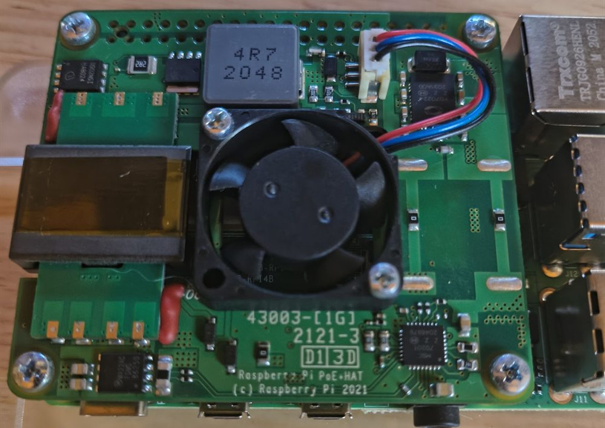
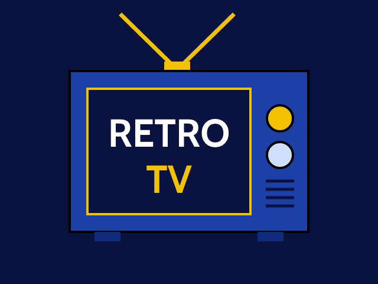
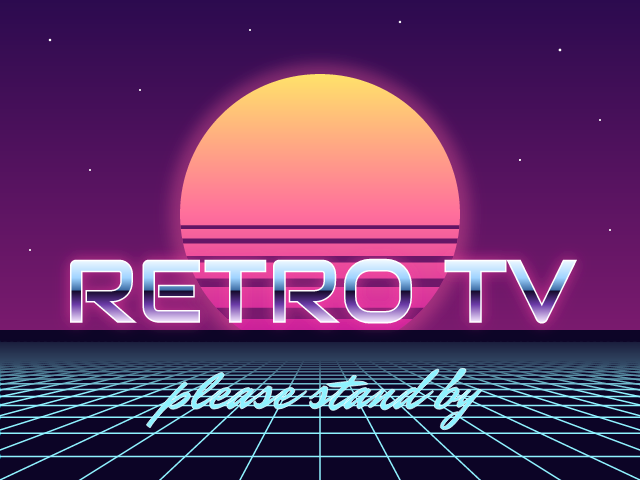

# Retro TV box: a Pi that boots into the guide

<p align="center">
  <a href="../README.md">Home</a> &nbsp;·&nbsp;
  <a href="../docker/README.md">Browser app</a> &nbsp;·&nbsp;
  <a href="../pi/README.md">Batocera Pi</a> &nbsp;·&nbsp;
  <b>Retro TV box</b> &nbsp;·&nbsp;
  <a href="../roku-tv/README.md">Roku</a> &nbsp;·&nbsp;
  <a href="../ersatztv/README.md">ErsatzTV channels</a>
</p>

A Raspberry Pi 4 that powers on into the Retro TV guide, full screen on a CRT, driven by an IR
remote. No Batocera, no Kodi: the box runs the [browser viewer](../docker/README.md) from
`docker/web/app`, served by its own web server, with a boot splash in the viewer's theme. This
folder holds the design, the configuration, and the script that turns a stock Raspberry Pi OS
Lite card into the box.

Where it stands: the script route (step 1, below) works on real hardware; the one-file image
(step 2) is not built yet. What is still untested is listed under "Not yet".

<table><tr><td align="center"><br><sub>What the box shows: the guide at 640×480, a show playing in the box</sub></td><td align="center"><br><sub>The official PoE+ HAT: one cable for power and network</sub></td></tr></table>

<table><tr><td align="center"><br><sub>Boot splash, Cable theme (640×480)</sub></td><td align="center"><br><sub>Boot splash, Vaporwave theme</sub></td></tr></table>

## Hardware

| Part | What is needed |
|---|---|
| Computer | Raspberry Pi 4 Model B. 2 GB is plenty. Power over Ethernet with the official PoE+ HAT (one cable, and the firmware runs its fan), or an ordinary USB-C supply |
| Card | A 16 GB microSD; the system needs about 3 GB |
| Screen | Any CRT with a composite input. Any TV with HDMI also works, at 640×480 |
| Video out | HDMI at 640×480 into an HDMI-to-composite converter (the same kind the [Batocera Pi](../pi/README.md) uses), or the Pi's own composite jack at 720×480i through a 4-pole 3.5 mm cable (see the display details for which plug carries the video). One setting switches between them |
| Remote | A "Windows Media Center" (MCE) USB IR receiver and any remote it understands; a universal remote can send power and volume to the TV and everything else to the box |
| Controller | A Bluetooth game pad, optional |
| Network | Wired from a PoE switch (one cable does power and data), or Wi-Fi. The box needs to reach the ErsatzTV server. Behind a CRT, 2.4 GHz reaches further than 5 GHz |

## Decisions

- **Base system: Raspberry Pi OS Lite, 64-bit** (current release). It has the Pi's video drivers,
  Chromium with hardware H.264 decoding, Plymouth, and `apt`. A fully custom Buildroot system was
  considered and kept as a possible later step; Pi OS gets there in days, not weeks.
- **The viewer runs on the box itself.** nginx serves `docker/web/app` and proxies `/iptv/` to
  ErsatzTV, using the very same `docker/web/nginx.conf.template` as the Docker container (only
  the port and root differ). Reasons: the box never shows a browser error page (if the server is
  down, the guide's own "Can't reach the TV server" message appears, in the theme's style); no
  dependency on another machine being up; and the viewer's theme can be read by the box (below).
- **Kiosk: `cage` + Chromium.** `cage` is a Wayland compositor that shows exactly one window, full
  screen, no desktop, no cursor. Chromium runs in kiosk mode with sound allowed from the start
  (the "press a key for sound" problem does not exist here) and its profile on a writable data
  area so the theme and other settings survive reboots. The page is `http://127.0.0.1:8410/?tv`:
  the plain 640×480 layout.
- **Boot splash: Plymouth, in the current theme.** The Pi's rainbow square and the scrolling boot
  text are turned off. Plymouth shows the theme's splash (the little television, or the sunset) as
  a still, from the same scene code as the viewer and the Roku app, rendered by
  `tools/render-splash`. Then the viewer's own animated splash takes over as the guide loads.
- **The theme follows the viewer's setting.** The viewer posts its theme to `/pi/theme` whenever
  it is applied (on every start and on every change). On the box, nginx passes that to a small
  local service (`retro-tv-themed.py`), which records the choice and points Plymouth's images at
  the matching splash, so the *next* boot already matches. Every viewer theme has a rendered
  boot splash; the service accepts whatever `splash-<theme>-*.png` files are installed. Plymouth
  draws from the initramfs on Pi OS, so the service rebuilds it afterwards: once, 20 seconds
  after the last change, at the lowest CPU and disk priority, for the running kernel only. Anywhere else (laptop, phone) the
  request answers 404 and is ignored. The same service takes the settings screen's **Power
  off** (`/pi/power`), which shuts Pi OS down cleanly; the row only appears on the box.
- **Wi-Fi comes from the boot partition, and a watchdog keeps it up.** Raspberry Pi Imager
  leaves the Wi-Fi name and password in `network-config` on the FAT boot partition, a file nothing
  rewrites. A small service (`retro-tv-net.sh`) rebuilds NetworkManager's Wi-Fi profiles from it
  at every boot if they are missing, and a timer checks the link every minute: when the router
  stops answering over Wi-Fi the radio is reconnected, and after six bad minutes the box reboots
  (then waits 30 minutes, then two hours, before trying another reboot while the network stays away).
  The settings screen shows what the box is connected through and the Wi-Fi signal (`/pi/net`).
- **Composite video from the Pi itself** is the end state: Pi OS can drive the 3.5 mm jack
  (Batocera cannot). The jack also carries the sound. The alternative is HDMI at 640×480 through
  a converter, exactly like the Batocera Pi's CRT profile, with the same kind of kernel margin
  settings for overscan. Switching between the two is one line in the box's config file.
- **IR: a USB MCE receiver, decoded by Linux.** The kernel's `mceusb` driver decodes the remote;
  a key map (`config/rc_keymaps/retro-tv-mce.toml`) turns its buttons into the plain keyboard
  keys the viewer already understands (arrows, Enter, Escape, Page Up/Down, digits, I, S, M, R).
  No wiring, no soldering, and the receiver can sit on top of the TV. The PoE+ HAT covers the
  GPIO header, which is why a USB receiver rather than a 3-wire module. Many MCE receivers also
  have IR *emitter* jacks: a later step can let the box switch the TV on and off itself.
- **TV power and volume stay with the TV.** A universal remote with "punch-through" sends power
  and volume to the TV and everything else to the box. The box itself is switched off from its
  settings screen (Power off, pressed twice), and the plug is pulled only once the green light
  is out: a Pi unplugged while running can lose files, its Wi-Fi profile among them. The Pi cannot be switched on by IR: power from fully off is the PoE switch's port (if
  it is managed) or the plug.
- **Read-only system, writable data** (planned for step 2). The root filesystem is mounted
  read-only with an overlay, so pulling the plug can never corrupt the card. A separate writable
  area (`/data`) holds the Chromium profile (the viewer's settings), the theme choice, Bluetooth
  pairings and logs.
- **Tailscale is optional, off by default.** With it on, and a subnet route for the home network
  advertised by something at home, the box works anywhere with ordinary Wi-Fi or a hotspot (not
  behind a hotel sign-in page: there is no browser to click through).
- **Two build steps.** First a provisioning script (`setup.sh`) that turns a stock Pi OS Lite card
  into the box, so every piece can be tried on a real Pi and CRT. Then `pi-gen` wraps that same
  script into a flashable image: write it to a card and the box is finished.

## How it starts

1. Power → firmware → kernel. Boot text is hidden; Plymouth draws the theme's splash.
2. The Wi-Fi profiles are checked against the boot partition, then the network comes up:
   Ethernet when a cable is in, Wi-Fi otherwise.
3. nginx starts with the viewer and the ErsatzTV proxy. The theme service starts.
4. `cage` starts on the console as user `tv` and launches Chromium in kiosk mode on the viewer.
5. The viewer shows its own animated splash while it loads the listings, then the guide.
6. The IR receiver's key map is loaded when the receiver is seen (`ir-keytable`), so the remote
   works from the first screen.

About 25 seconds from power to SSH on a Pi 4; the guide follows a few seconds later.

## Files

```
pi-image/
├── README.md                      this page
├── setup.sh                       turns a fresh Pi OS Lite into the box; run again after changes
└── config/
    ├── retro-tv.env.example       the box's settings: server address, display mode, margins, extra Wi-Fi name, Tailscale
    ├── retro-tv-kiosk.sh          starts Chromium in kiosk mode on the viewer (run by cage)
    ├── retro-tv.service           systemd: cage on the console as user tv
    ├── retro-tv-themed.py         the local service behind /pi/theme (records the choice, updates Plymouth) and /pi/power
    ├── retro-tv-themed.service    systemd unit for it
    ├── retro-tv-net.sh            restores the Wi-Fi profiles from the boot partition; the network check behind /pi/net
    ├── retro-tv-net-restore.service   runs the restore before NetworkManager at boot
    ├── retro-tv-net-check.service     one check; retro-tv-net-check.timer runs it every minute
    ├── retro-tv-net-check.timer
    ├── nginx-pi.conf              the Pi-only additions to the viewer's nginx config (/pi/)
    ├── plymouth/retro-tv/         the boot splash theme: script, config, and the rendered scenes
    └── rc_keymaps/retro-tv-mce.toml   MCE remote buttons → the viewer's keys
```

The splash pictures in `config/plymouth/retro-tv/` are generated, not drawn by hand. In
`tools/render-splash`, after `npm install` and `python fonts.py` (which unpacks the viewer's web
fonts for the rasterizer), `node render.mjs` renders every theme's scene at 640×480 (HDMI),
720×480 (composite, non-square pixels) and 1920×1080, and the Roku app's icons, from
`docker/web/app/js/splash.js`. Re-run it when the scenes change or a theme is added.

## Building the box, step 1: a stock card plus `setup.sh`

1. **Flash** Raspberry Pi OS Lite (64-bit) with Raspberry Pi Imager. In its settings: hostname
   `retro-tv`, a user with a password of your choice, SSH on with public-key login only, and your
   SSH public key. Wi-Fi is not needed on a wired network.
2. **Boot** it on the network, then `ssh <user>@retro-tv.local`. If the user Imager created has
   no passwordless `sudo`, add a line for it under `/etc/sudoers.d/`; `setup.sh` needs root.
3. **Get the repo** onto it (`git clone`, or `rsync` from another machine) and run
   `sudo pi-image/setup.sh`. The first run copies `config/retro-tv.env.example` to
   `/etc/retro-tv.env` and stops so you can fill in the ErsatzTV address and the display mode;
   run it again and it does everything else, then reboots into the guide.
4. **Tune the picture** on the CRT. Set `PAGE=overscan` in `/etc/retro-tv.env`, run
   `sudo pi-image/setup.sh` and reboot: the viewer shows a test pattern with a white frame at
   the edge. Adjust the margins in the same file (a bigger number pulls the picture in from that
   edge) until the frame is just visible on every side, then set `PAGE=guide` (or `tvguide`
   for the scrolling listings page, with `TVGUIDE_PROMO=` naming the channel that plays in its
   top half). Margins take a
   reboot; the page only `systemctl restart retro-tv`. As a starting point, a 12-inch set
   through a converter needed left 19, right 21, top 10, bottom 6; the same set on the Pi's own
   composite output needed left 45, right 37, top 10, bottom 6 (the sides overscan far more
   than the converter did, the height did not change).

`setup.sh` is written to be safe to run repeatedly: it installs what is missing, rewrites the
files it owns, and leaves the rest alone. A full install takes about 4 minutes.

## Step 2: the image (`pi-gen`)

Not built yet. A `pi-gen` stage that runs `setup.sh` inside the image build, plus the read-only
overlay and the `/data` partition, produces `retro-tv-<date>.img.xz`. Building needs a Linux
machine (or WSL) and about 30 minutes. Until then, step 1 gives a working box, just not a
one-file one.

## Display details

- **HDMI 640×480:** `video=HDMI-A-1:640x480@60` on the kernel command line plus the margins
  (`margin_left=…` and so on), the same mechanism as the Batocera Pi's CRT profile. The
  converter makes 480i from it. The mode is also given for `HDMI-A-2`, so either port works.
- **Composite:** `dtoverlay=vc4-kms-v3d,composite` and `enable_tvout=1` in `config.txt`, and
  `video=Composite-1:720x480@60ie` on the command line (NTSC). The picture is 720×480 with
  non-square pixels, shown as 4:3 by the set. The kiosk adds `&screen=4:3` to the viewer's
  address, and the viewer lays its 640×480 `?tv` page out for a 4:3 screen and stretches it to
  the 720 pixels (without that, the guide sat in the middle with a black bar at each side).
  Margins work the same way. The jack is a 4-pole 3.5 mm socket wired left, right,
  ground, **video on the sleeve**; a camcorder-type TRRS lead has video and right audio the
  other way round, so on it the Pi's video comes out of the *red* plug. In this mode the Pi 4's HDMI ports are off (the
  overlay's `composite` option does that), so a screenshot or a monitor for debugging is not an
  option; SSH is.
- On a small tube (12 inches) the guide's text is on the small side; the viewer's design units
  make a size bump a CSS change.

## The remote

- **Receiver:** any "Windows Media Center" USB IR receiver (Linux driver `mceusb`). Those with
  two 3.5 mm emitter jacks can later control the TV too.
- **Key map:** `config/rc_keymaps/retro-tv-mce.toml` maps the standard MCE remote codes:
  arrows → arrows, OK → Enter, Back/Clear → Escape, Guide → Escape (the viewer's "back" toggles
  guide and picture), Info → I, Channel +/− → Page Up/Down, digits → digits, Mute → M, the
  green Windows button → S (settings), Record → R (reload listings). Power and volume are left
  to the TV. `ir-keytable` loads it through `/etc/rc_maps.cfg` whenever the receiver appears.
- **Any other remote** can be used once its codes are known: `ir-keytable -t` prints what the
  receiver sees while you press buttons, and the map is a text file.
- **Universal remote:** program the TV device with the TV's codes and the box as a
  "Media Center PC" (or learn the MCE remote's codes), with volume and power punched through to
  the TV.

## Things that bit, and their fixes

Each of these is handled by `setup.sh` or the kiosk script now; they are listed so the reasons
survive.

- **The compositor picks the display's preferred mode, not the kernel's.** `cage` (wlroots)
  started the converter at its preferred 1280×720 whatever `video=` said. The kiosk script sets
  the mode from inside the session with `wlr-randr` before starting Chromium; the kernel line
  still carries the mode and the margins (the margins are connector properties the compositor
  leaves alone).
- **Never write `@60D` in `video=`.** The `D` suffix means "force this connector on". With it,
  the empty second HDMI port became a phantom 1024×768 display and `cage` spread the screen
  across both. Plain `@60`, given for both ports. The same goes for `hdmi_force_hotplug=1`,
  which is not needed: the converter presents an EDID.
- **The CEC devices are the "mouse".** Each HDMI port has a CEC remote-control input that
  libinput classes as keyboard + pointer, and a pointer makes `cage` draw a cursor in the middle
  of the screen. A udev rule hides them (and game pads) from libinput; with no input devices
  left, wlroots refuses to start unless `WLR_LIBINPUT_NO_DEVICES=1` is set, so the service sets
  it. The viewer also hides the pointer in `?tv` mode.
- **No Ethernet link means Wi-Fi, silently.** If the cable is out or the switch port is off, the box
  comes up on Wi-Fi and nothing on screen says so. On a weak 5 GHz link that means bursts of lost
  packets: nginx's connects to the server time out, and the guide shows "Channel unavailable,
  retrying…" for a few seconds at a time. Plugging the cable in fixes it at once (NetworkManager
  prefers Ethernet). The settings screen
  now shows the path and the signal, and the network check reconnects or reboots on its own.
- **Do not pin the Wi-Fi band over SSH.** Many dual-band routers broadcast two names, such as
  `Home` and `Home - 5G`; a profile for the 5 GHz name pinned to 2.4 GHz can never associate,
  and a headless box is then unreachable. Give the 2.4 GHz name as `WIFI_EXTRA_SSID` instead
  and let NetworkManager choose.
- **A power cut took the Wi-Fi profile with it.** NetworkManager rewrites a profile's file each
  time the network connects. A box unplugged while running on Wi-Fi can come back with no Wi-Fi
  profile at all: no network, and no way to say so. Imager's `network-config` on the boot partition survives, and the
  restore step rebuilds the profiles from it at every boot.
- **The composite cable's yellow plug gave nothing.** Pi OS was driving the jack (the kernel
  showed `Composite-1` connected, and a `grim` capture under `cage` showed the guide), but the
  tube stayed dark. The cable was a camcorder lead, which carries the Pi's video on its red plug:
  red into the TV's video input, and the picture appeared. A cable sold for the Pi (or a Zune)
  is wired the Pi's way.
- **The margin test pattern was never styled.** nginx sends a Content-Security-Policy for the
  viewer that forbids inline styles, so the pattern page's `<style>` was silently dropped: the
  image drew at its own 640×480 in the top-left corner with the browser's default 8 px margin.
  On the 640×480 HDMI mode this was nearly invisible; on composite (720 wide) it was obvious.
  The style is a separate file now (`overscan.css`) and the image fills the screen.
- **Flipping through themes made the box crawl.** Each theme change rebuilt the initramfs at
  once, for every installed kernel, at normal priority, and several presses in a row ran several
  rebuilds at the same time. Now the
  rebuild waits for 20 quiet seconds, runs once under `nice` and `ionice`, and only for the
  kernel this Pi boots; it takes about 15 seconds and the guide does not notice.
- **Sound defaulted to the headphone jack.** PipeWire picks the 3.5 mm jack as the default
  output, so HDMI got silence. The kiosk script makes the HDMI output the default at full volume
  (the jack in composite mode, where it carries the sound). On Trixie the jack is called
  "Built-in Audio", not "Headphones"; the script accepts either.
- **Logging in over SSH turned the TV down.** Each login by the admin user started a second
  PipeWire and WirePlumber for that user, and the second WirePlumber put the sound card back to
  its default level, 40 %. The picture carried on and the sound dropped, until the next reboot
  or kiosk restart. `setup.sh` now lets the sound services start for the kiosk user only
  (drop-ins under `/etc/systemd/user/`). To check: `wpctl get-volume @DEFAULT_AUDIO_SINK@` as
  the kiosk user says 1.00, before and after a fresh SSH login.

## Not yet

- The IR receiver has not been tried on hardware.
- A "standby" action for the remote's power button (blank the picture, stop the stream, without
  shutting down) needs a small viewer change.
- The box controlling the TV through an IR emitter.
- Tailscale: a settings-screen switch for it would need a second local endpoint like
  `/pi/theme`.
- Step 2, the image.

## Conventions

Nothing personal in this folder: the server address lives only in `/etc/retro-tv.env` on the
box (and in the git-ignored `pi-image/retro-tv.env` if kept locally). SSH keys never enter the
repo.
