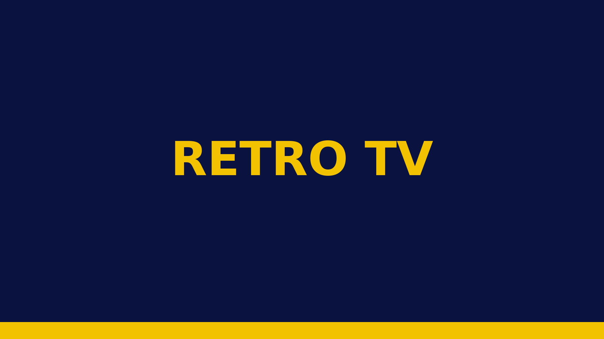
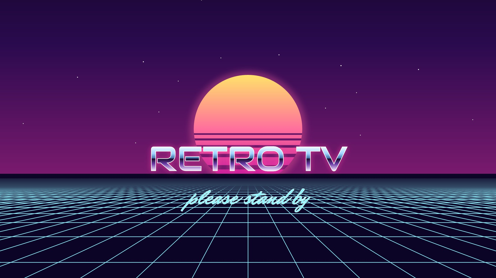
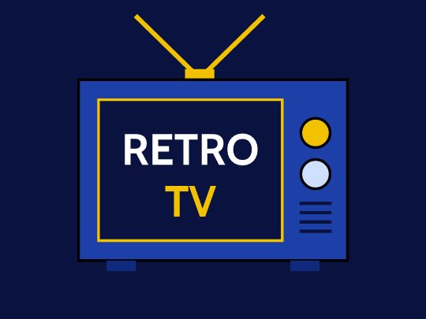

# Retro TV for Roku

<p align="center">
  <a href="../README.md">Home</a> &nbsp;·&nbsp;
  <a href="../docker/README.md">Browser app</a> &nbsp;·&nbsp;
  <a href="../pi/README.md">Batocera Pi</a> &nbsp;·&nbsp;
  <a href="../pi-image/README.md">Retro TV box</a> &nbsp;·&nbsp;
  <b>Roku</b> &nbsp;·&nbsp;
  <a href="../ersatztv/README.md">ErsatzTV channels</a>
</p>

The ErsatzTV channels on a Roku, with the same look as the browser viewer (`../docker/`):
full-screen live TV and a channel bar along the bottom. It talks to ErsatzTV directly, so it
works on the home network only (a Roku cannot join a tailnet).

<table><tr><td align="center"><br><sub>Splash and channel icon, Cable theme</sub></td><td align="center"><br><sub>Vaporwave theme</sub></td><td align="center"><br><sub>The home-screen tile</sub></td></tr></table>

**What it has:** the guide grid with the picture in the corner box, show details, settings, the
channel bar while watching, Standard/HD, and all nine themes with their splash screens and the
theme picker. Not here,
on purpose: the viewer's fast-flipping warm-up, "Fill the screen" and typing a channel number (a
Roku remote has no digits).

| Remote | In the guide | Watching |
|---|---|---|
| Arrows | Move the highlight; hold Up / Down to go faster. Up from the top row reaches the settings cog (Up again wraps to the last channel); Down on the last channel wraps to the first | Up / Down change channel; Left / Right pick a button on the channel bar |
| OK | Watch the highlighted channel | Show the channel bar, or press its highlighted button |
| Play / Pause | Show details | Sound on / off |
| Replay or `*` | Settings | |
| Rewind / Fast-forward | Page through channels | Channel down / up |
| Back | Back to the picture (or leave the app) | Back to the guide |

**Settings** (Replay or `*`): **Theme** (OK opens the picker: all nine themes as tiles in their own
colours and faces; arrows move, OK takes one, the whole guide changes at once and the new theme's
splash plays for two seconds), **Quality** (Standard or HD; HD needs the channel's
twin, see `../ersatztv/README.md`), and the **TV server** address. They are kept on the Roku, so
each Roku has its own.

On first start it asks for the ErsatzTV address (`<server-ip>:8409`). It remembers that and the
last channel watched, which starts playing in the corner box the next time the app opens. If the server stops answering, the guide's message says how to change the
address (Replay).

**The splash.** Roku shows the app's start-up picture itself, and that one is fixed at install:
the Cable television. The app then shows the current theme's splash for two seconds over the
loading guide (the Cable one continues the start-up picture without a cut). They are stills of
the scenes the browser viewer draws, rendered from `../docker/web/app/js/splash.js`.

**The themes on a Roku.** A Roku draws flat, square rectangles and has no CSS, so the themes are
the viewer's in colour, type and layout, with two differences. Where the viewer has a gradient,
the Roku has its middle colour (a light shade toward the bottom of the rounded cells stands in
for the gloss); glows and see-through tiles are left out. Rounded cells, the Set-Top Web bevel
and the TV Guide frames are small stretchable pictures (`images/*.9.png`). Cable, Vaporwave,
Set-Top Web and TV Guide come out the same as in the browser; Digital Cable, Satellite, DVR,
Media Center and Aqua are close.

## Installing it on your Roku (sideloading)

No Roku account or store review is needed for your own Roku.

You need a computer with `git`, `bash` and `zip` (and `curl` if the script is to do the upload),
and an ErsatzTV server of your own on the same home network as the Roku
([how the channels are built](../ersatztv/README.md)). Get the code with
`git clone https://github.com/awall451/retro-tv.git` and work in its `roku-tv/` folder.

1. **Developer mode.** On the Roku remote press **Home ×3, Up ×2, Right, Left, Right, Left,
   Right**. Accept the agreement, choose a password, and let it restart. The screen shows the
   Roku's address (`http://<roku-ip>`).
2. **Build and install.** The app is a plain zip of this folder's files; nothing is compiled.
   - **By hand:** `./install.sh` builds `out/retro-tv.zip`. Open `http://<roku-ip>` in a browser,
     sign in as `rokudev` with your password, choose the zip, press **Install**.
   - **In one go:** give the script the Roku's address and password and it uploads too:
     ```bash
     ROKU_IP=<roku-ip> ROKU_DEV_PASSWORD=<password> ./install.sh
     ```
     or put those two lines in `roku-tv/.env` (git-ignored) and run `./install.sh`.

   "Install Success" means it is on the Roku and starts at once. Do the same after every change.
3. **Debug output.** `telnet <roku-ip> 8085` shows the app's log and any BrightScript error with
   its line number.

Only one sideloaded app can be on a Roku at a time; installing replaces it.

## Files

| Path | What |
|---|---|
| `manifest` | App name, version, icons |
| `source/main.brs` | Opens the screen |
| `components/MainScene.*` | Video, guide, channel bar, remote keys, the themes, settings in the registry |
| `components/ChannelsTask.*` | Reads `/iptv/channels.m3u` from ErsatzTV |
| `images/` | Icons and the start-up splash (Cable), every theme's splash, the cog and "playing" mark (white, tinted by the app), the cell shapes (`*.9.png`). All made by `../tools/render-splash` |
| `fonts/` | The themes' faces as TTF, with their licences (PrevueGrid is not ours: see its NOTICE) |
| `install.sh` | Zip and sideload |

Streams are ErsatzTV's HLS (`/iptv/channel/<n>.m3u8?mode=segmenter`), the same ones the
browser viewer plays. HD plays channel number + 100 when the server has that twin.
